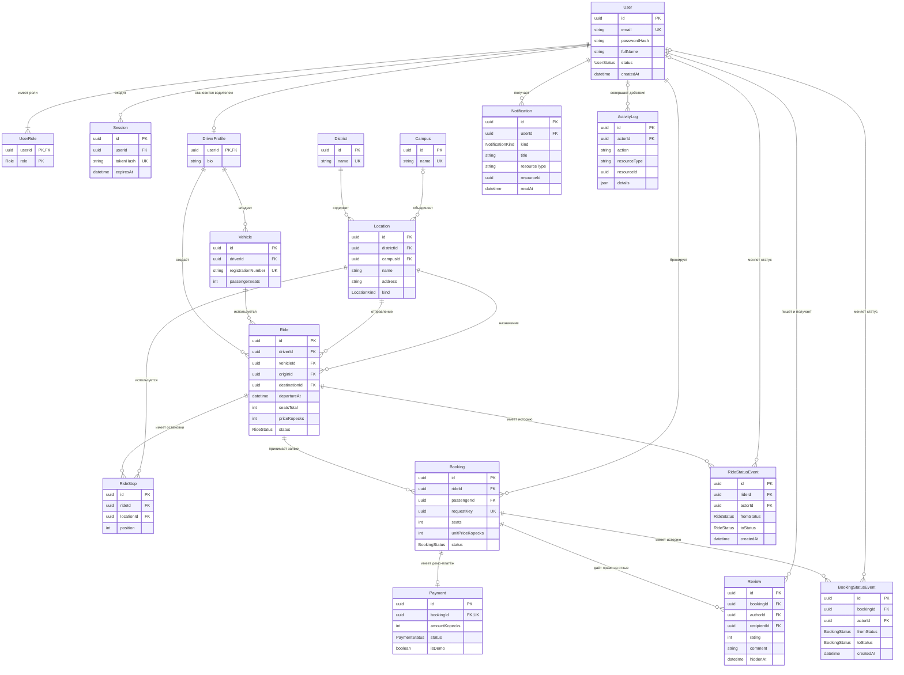

# Модель данных

Целевая модель содержит **17 сущностей** и реализована в [Prisma-схеме](../apps/api/prisma/schema.prisma). Первичная SQL-миграция: [migration.sql](../apps/api/prisma/migrations/20261019000100_initial/migration.sql).

ER-диаграмма ниже отображается средствами GitHub. Редактируемый вариант для diagrams.net / draw.io: [database.drawio](database.drawio). После изменения схемы нужно синхронизировать обе визуализации и создать миграцию.

Диаграмма показывает ключевые поля; полный перечень, необязательность, индексы и правила удаления определены Prisma-схемой. Начальные события имеют `fromStatus = null`. Участие пользователя как автора и получателя отзыва — две отдельные внешние связи в схеме.

## Назначение сущностей

1. **User** — данные аккаунта, пароль в виде хеша, принадлежность к университету и состояние блокировки.
2. **UserRole** — назначенные роли; составной ключ позволяет совмещать водителя и пассажира.
3. **Session** — серверные сессии с хешем токена и сроком действия.
4. **DriverProfile** — дополнительное описание водителя; ключ совпадает с UUID пользователя.
5. **Vehicle** — автомобили водителя и пассажирская вместимость.
6. **Campus** — справочник корпусов/кампусных направлений УрФУ.
7. **District** — жилые районы и микрорайоны Екатеринбурга.
8. **Location** — именованная точка с адресом и районом; принадлежность корпусу необязательна. Точный адрес и описание определяют место встречи без карты.
9. **Ride** — маршрут, водитель, автомобиль, отправление, места, цена, условия и состояние.
10. **RideStop** — промежуточная остановка с порядковым номером в маршруте.
11. **Booking** — заявка пассажира, места, снимок цены, ключ запроса и состояние.
12. **Payment** — один демонстрационный платёж на заявку; его же запись фиксирует полный возврат.
13. **Review** — оценка от одного участника другому по завершённому бронированию, признаки модерации.
14. **Notification** — сообщение конкретному пользователю, время прочтения и ссылка на объект.
15. **ActivityLog** — история прикладных и административных действий без секретных данных.
16. **RideStatusEvent** — история состояний поездки с автором и причиной.
17. **BookingStatusEvent** — история состояний заявки с автором и причиной.

`Notification.resourceId` и `ActivityLog.resourceId` — ссылки на разные типы сущностей, поэтому не являются внешними ключами к одной таблице. Тип и доступность объекта проверяет прикладной сервис. Уведомление не предоставляет права на закрытый объект само по себе.

## Ограничения

Prisma задаёт первичные/внешние ключи, уникальность email, номера автомобиля, ключа запроса, пары `(rideId, position)` и пары `(bookingId, authorId)`. Email и номер автомобиля нормализуются сервисом до записи. У заявки не больше одного платежа.

Дополнительный SQL в начальной миграции задаёт:

- положительное число мест, пассажирскую вместимость автомобиля и поездки в диапазоне 1–8;
- неотрицательные денежные значения;
- различные точки отправления и назначения;
- положительный порядковый номер остановки;
- оценку 1–5, запрет отзыва себе и длину текста 1–1000 после удаления пробелов;
- обязательность `isDemo = true` у платежа;
- частичный уникальный индекс `(rideId, passengerId)` для `PENDING`/`CONFIRMED`.

SQL-ограничения и частичный индекс поддерживаются миграциями: Prisma-схема не описывает их полностью. Применять `db push` вместо миграций нельзя — эти гарантии могут быть потеряны.

Прикладные транзакции обеспечивают то, что нельзя выразить обычным `CHECK` одной строки: отсутствие переполнения при конкурентном бронировании, принадлежность автомобиля водителю, право на отзыв, соответствие получателя участникам, верные переходы и согласованность возвратов.

## Хранение и вычисления

- UUID генерируются Prisma при записи через клиент. При ручной SQL-вставке UUID нужно задавать явно.
- Время хранится в `timestamptz(3)`, отображается в часовом поясе Екатеринбурга.
- Денежные поля — целые копейки, валюта — RUB.
- Остаток мест вычисляется: `seatsTotal − SUM(seats)` активных заявок.
- Рейтинги вычисляются по нескрытым отзывам, отдельно для водительской и пассажирской стороны.
- История поездок, заявок, платежей и отзывов не удаляется каскадно вместе с пользователем. Для управления доступом используется блокировка.
- Каскадное удаление допустимо для сессий, назначений ролей, уведомлений и остановок удаляемого черновика. Журнал сохраняет действие с пустым автором, если его аккаунт удалён вне обычного пользовательского сценария.

## Статус реализации

Prisma-схема, SQL-миграция и ER-диаграмма подготовлены. Миграция проверена на PostgreSQL 17 в Docker; повторное применение не создаёт изменений. Сравнение живой БД с Prisma-схемой не выявило различий. В БД 17 предметных таблиц и служебная таблица `_prisma_migrations`.

Команда `bun run db:test` выполняет [SQL-проверки](../scripts/check-database.sql) на настоящей БД: связи, частичная уникальность активной заявки, возможность повторной заявки после отмены, ограничения мест/цен/маршрута, один демо-платёж и двусторонние отзывы. Всё выполняется в транзакции с `ROLLBACK`, тестовые записи не сохраняются. Эта же проверка включена в CI.

Прикладные сценарии, заполнение демо-данными и защита от конкурентного бронирования последнего места ещё предстоят: SQL-ограничения сами по себе не заменяют транзакционную прикладную логику.
